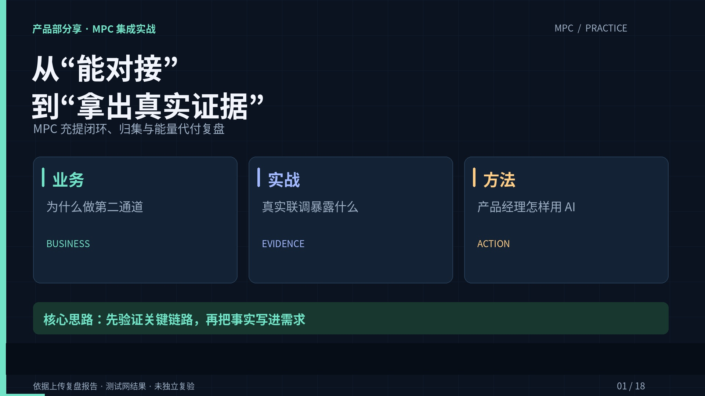

# MPC 集成实战复盘｜讲解视频

约 **9 分 20 秒**，720p 横屏，中文合成旁白与嵌入字幕。

**[下载视频](https://github.com/abuluo/MPC-share/raw/refs/heads/share/mpc-practice-video-20261017/practice-video/mpc-practice-review.mp4)**

如果网页没有直接播放，可在视频文件页选择 **Download raw file** 下载后播放。

## 内容

围绕三条主线展开：引入第二通道的背景、测试网真实联调与七个踩坑案例、产品经理用 AI 前置验证并产出需求的方法。

特别区分零能量费与整笔交易零费用、暂时请求失败与订单最终失败、测试网记录与主网验收，以及原型示意与真实运行截图。

## 配套材料

- [讲稿与章节时间](script.md)
- [独立 SRT 字幕](subtitles.srt)
- [术语读音说明](pronunciation.md)
- [术语试听 MP3](pronunciation-check.mp3)
- [上一份钱包与发卡全景视频：读音修正版](../video/README.md)

## 发音处理

专用词典按金融场景固定“发卡”为 **fā kǎ**，卡片、银行卡的“卡”读 kǎ；私钥、公钥、密钥的“钥”读 yuè；回调的“调”读 diào；重试的“重”读 chóng。MPC、KYT、API 等缩写使用英文字母读法。

已通过模型调试核对关键术语实际使用的音素与声调。完整语音未出现未知词警告；词典核对不等同于人工听感审校，单独提供术语试听。

## 来源与边界

依据上传的 `mpc-share-report.html`，原文标题为“MPC 集成实战复盘 · 产品部分享”。视频解释报告中的测试网开发调试记录，未独立复验原项目。画面为新绘制的讲解图，非真实系统截图。视频没有声称已经完成主网验收或彻底消除同供应商的共同故障风险。

视频格式：H.264 Constrained Baseline + AAC-LC，1280×720、24 fps，支持渐进下载。
