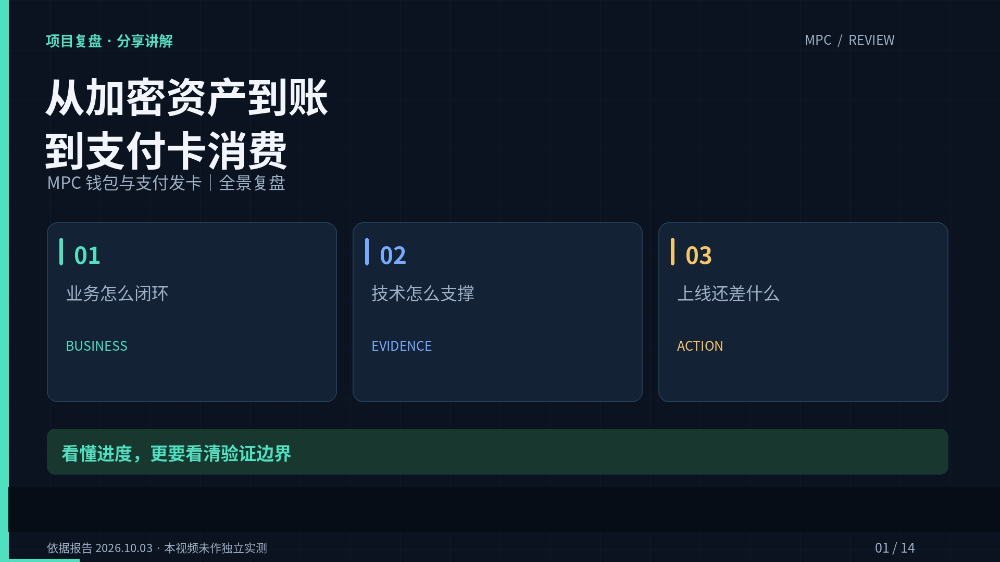

# MPC 钱包与支付发卡｜分享讲解视频

约 7 分 01 秒，720p 横屏，含中文合成旁白和嵌入字幕。

[下载 MP4 视频（约 18 MB）](https://github.com/abuluo/MPC-share/raw/refs/heads/share/mpc-review-video-20261017/video/mpc-review.mp4)

如果 GitHub 未直接播放，请点击视频文件页的 **Download raw file**，下载到本地播放。

- [中文讲稿与章节时间](script.md)
- [独立 SRT 字幕](subtitles.srt)

内容包括业务全景、系统分工、充提币资金流、TRON 能量优化、Reap 与 Bridge 对比、KYC 及上线缺口。

依据上传的《MPC钱包与支付发卡-全景综合文档》，报告版本 2026-10-03。视频解释的是报告当时记录的状态，保留“真实联调／本地模拟／待确认”的区分，未独立复验报告中的供应商政策和系统测试结果。

格式为 H.264 Constrained Baseline + AAC-LC，1280×720，24 fps；仅含视频和音轨，支持渐进下载。文件已通过完整解码检查和本地 Chromium 播放检查。
